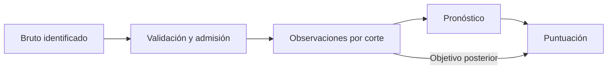

# KS-007 · Cadena temporal reproducible y valor del laboratorio

**Corte** · 24 de noviembre de 2026, Ecuador.  
**Alcance** · Una cadena de datos ejercitada de extremo a extremo, evaluación exploratoria del instrumento WORLD-LAB y comprobación local de reglas web.  
**Marco** · [Especificación Estratégica](https://chatgpt.com/library?file_id=libfile_e0932365a6ac8191a15982b0355879e0&account_id=personal) · [RDL-PB-001](https://github.com/ksgfin8-cyber/yellow/blob/5d40f08/docs/program/RDL-PB-001_v0.1_original_propuesta.md) · [KS-004](KS-004_CONSTRUCCION_TECNOLOGICA.md) · [KS-006](KS-006_DIMENSIONES_Y_RECUPERACION.md)

## Dictamen

**Operar la cadena en replay histórico acotado.** Una sola fuente consumida por dos referencias permitió regenerar y verificar bruto, normalización, cuarentena y evaluación. La disponibilidad histórica se simuló explícitamente. La observación en vivo, los tiempos reales de publicación y la transferencia a otra fuente quedan por demostrar.

**Conservar WORLD-LAB para preguntas de trayectoria.** Los cuatro resúmenes terminales conservaron sus valores bajo la alteración ensayada. El replay aceptó las trayectorias limpias y rechazó las cuatro alteradas. El control acredita valor para integridad interna. Queda pendiente medir el valor adicional al estudiar el mecanismo de una política con memoria.

**Mantener la web en alcance local hasta disponer de un receptor de campo.** La validación local permite preparar el protocolo. La recepción efectiva y la carga operativa dependen del canal y del comercio. La cartera conserva 14 repositorios tecnológicos. Este repositorio preserva los instrumentos y resultados y TN cuenta como un único objeto.

## 1. Protocolo anterior a la ejecución

## Cadena temporal

Fuente única: instantánea del CSV diario de VIX en el repositorio público datasets/finance-vix, commit 3dbea23c70cc2afbeeec8ac232c9ec72ac26ac21, blob c05e0d9c28ddf3b98d0531017ef5b5180df05ae1, proveedor ascendente Cboe según el mantenedor. Conservar bytes originales en captura local y verificar Git SHA-1 y SHA-256. La disponibilidad real del archivo es la de la captura; no hay tiempos históricos observados de publicación ni primeras versiones de las filas. Para ejercer la evaluación, usar un escenario explícito de replay en que cada cierre entra al corte simulado a las 00:00 UTC del día calendario siguiente. Separar las marcas de ocurrencia (fecha de sesión), publicación simulada y recepción de archivo. No declarar tiempo real ni ausencia de revisiones históricas.

Consumidor: pronóstico del cierre de la siguiente observación válida con último cierre y media móvil causal de cinco cierres (siete en el cambio de configuración). Reportar orígenes, objetivos, MAE emparejado y huellas; comparación descriptiva sobre la instantánea, orígenes desde 2025-01-01, sin ajustar parámetros. No simular órdenes. T1/GEI originales tienen prerrequisitos contradichos en TN-R01; usar estas referencias para calificar el recorrido. No reabrir ni puntuar TN mientras las unidades y cortes internos sigan abiertos.

Aceptación: identidad exacta del bruto, reglas de esquema y dominio explícitas, dos corridas idénticas y lectura por el consumidor desde la salida de ingesta. Controles manuales antes del contraste real: falta declarada por calendario de fixture (sin imputar), duplicado idéntico, revisión explícita (no disponible antes de su marca), observación fuera de orden (no disponible antes de arribar), revisión conflictiva, cambio de sufijo que conserva pronósticos anteriores y resultado de media de cinco conocido. En producción experimental, no inferir falta de sesión del calendario civil ni imputar. Medir cambio solo de ventana de 5 a 7 sin tocar el adaptador de datos: archivos de salida que cambian, pasos manuales y tiempo de proceso descriptivo.

## WORLD-LAB y creación tecnológica

Pregunta: ¿qué aporta la trayectoria cuando el resumen de un episodio conserva sus valores terminales? Usar núcleo y runtime de yellow 5d40f08, perfil de desarrollo P01, semillas 1 y 2 y políticas wait y rule. Conservar la misma configuración por semilla. Control aislado: proyección terminal de estado (duración, energía, motivo). Contraste: registro de estado por paso y validador de replay del mismo motor. En una copia en memoria, cambiar solo energía en un estado interior, conservando el último estado. Exigir que la proyección terminal resulte idéntica, que el replay válido pase y que el control adulterado sea rechazado. Localizar el primer índice con una comparación sobre el campo. Reportar tiempos aislados solo como mediciones descriptivas y evitar semillas reservadas o conclusiones sobre calidad de agentes.

En una decisión de la cadena comparar una topografía de dependencias y una tabla temporal contra los mismos casos de prueba. Registrar utilidad observada, duplicación de información y cambio de decisión si lo hay. Una misma revisión por el mismo operador solo permite comparación descriptiva.

Web de campo requiere receptor y acceso al paso de pedido a recepción. Si faltan, preparar un contraste local de reglas y consignar por separado la aceptación de campo.

Registro local previo, 19:33:33 UTC. SHA-256 del protocolo original `2209cdb519906a7a110c7f1f0faedac403e7eb541cabda37f28af84b1f1ab698`.

## 2. Cadena de datos y consumidor

**Procedencia.** Se capturaron el 24 de noviembre de 2026 los 482.200 bytes del CSV [datasets/finance-vix@3dbea23](https://github.com/datasets/finance-vix/blob/3dbea23c70cc2afbeeec8ac232c9ec72ac26ac21/data/vix-daily.csv). El mantenedor declara [Cboe](https://www.cboe.com/tradable_products/vix/vix_historical_data) como proveedor ascendente. La identidad de la captura coincide con el blob Git `c05e0d9c28ddf3b98d0531017ef5b5180df05ae1`. Cada corrida copia los bytes sin modificación. La copia de la captura se preservó también fuera del repositorio de resultados. La fecha de captura acredita cuándo se accedió al archivo, sin fijar el instante original de publicación de cada fila.

**Ajuste de admisión.** La primera ejecución estricta encontró una apertura de 19,24 por encima del máximo de 18,57 en la línea 535. Un barrido separado identificó 47 contradicciones OHLC, todas anteriores a 2025. Se preservó el fallo estricto por defecto y se añadió una política explícita de cuarentena antes de regenerar. Cada fila conserva posición, valores originales y causa. La regla de evaluación, la muestra y las dos ventanas se mantuvieron. SHA-256 de la decisión local de ajuste `5c2dd4699ed92a85014269b0610b535ec99b80d3a013d8741c7aa165431bdab9`.

Las **9.231 observaciones admitidas** se serializaron y el evaluador volvió a leerlas desde el archivo generado. Los cinco controles automáticos aprobaron. Ejercitaron anormalidad OHLC, cuarentena, duplicado, llegada fuera de orden, falta según calendario de una fixture, revisión, conflicto de revisión, media manual e invariancia del pronóstico anterior a una perturbación. En el CSV real se registraron cero duplicados de la clave evaluada. El extracto histórico trae una sola versión por sesión, de modo que cero revisiones observadas describe el archivo. Para esta fuente se usó la secuencia de observaciones admitidas. La cobertura completa del calendario de sesiones queda pendiente.

| Consumidor | Orígenes emparejados | MAE del último cierre | MAE de la media causal |
| --- | ---: | ---: | ---: |
| Ventana 5 | 444 | 1,166216 | 1,556140 |
| Ventana 7 | 444 | 1,166216 | 1,747860 |

MAE en puntos de VIX. Orígenes del 2 de enero de 2025 al 21 de septiembre de 2026. Último objetivo el 22 de septiembre de 2026. El objetivo por origen fue el cierre de la siguiente observación admitida. El último cierre obtuvo menor error medio en este contraste descriptivo. Los resultados califican el recorrido del instrumento y el desempeño de las referencias en esta muestra. Los prerrequisitos de unidades y cortes de TN permanecen abiertos y esta ejecución no lo puntuó.

**Cambio representativo.** Cambiar de cinco a siete cierres exigió un argumento de CLI y cero cambios al adaptador o al código. El bruto, la cuarentena y las observaciones normalizadas coincidieron byte por byte. Cambiaron las filas de puntuación y el manifiesto. Las tres ejecuciones completas observadas tomaron aproximadamente 0,71, 1,13 y 0,86 s de pared. Son mediciones locales de proceso. El esfuerzo humano de construir otra integración y la productividad comparativa quedan pendientes.

| Archivo | SHA-256 |
| --- | --- |
| `bruto.csv` | `570e05630c9a5e7350d0c3dbe3acc58e793cb5248181ab0e949c121cc082fb83` |
| `observaciones.jsonl` | `bf6d05b4c985e21ee4a0b4b7960dc546994f5ba30d5aa48c86fcb18aa8a40aa2` |
| `cuarentena.jsonl` | `7396170c24558d1f7296ac6b357b23d6f0ff27de193c2f9511e8b7afa01636d0` |
| `evaluacion.jsonl`, ventana 5 | `2a8c9aa319390afbecce82cd345151fff4ce902debcfb4ff8a35353e31c53b65` |
| `evaluacion.jsonl`, ventana 7 | `db7b4e6314f8fb17b5afa1802dc7aee1d028a38c04934bb32a8868acf3ae1882` |

Las dos corridas de ventana 5 produjeron los mismos cinco archivos byte por byte.

### Decisión de diseño y representación



| Caso usado para revisar el diseño | Qué permite comprobar el mapa | Qué precisa la tabla temporal |
| --- | --- | --- |
| Revisión de una sesión anterior | El evento revisado entra por admisión, conservando el bruto. | El corte anterior ve revisión 1. El corte posterior puede ver revisión 2. |
| Cierre posterior perturbado | La vía del objetivo termina en puntuación. Una arista del objetivo al pronóstico contradiría la frontera. | Fija quién puede cambiar. El pronóstico anterior se conserva y el objetivo posterior puede cambiar. |
| Rango OHLC contradictorio | La clasificación ocurre antes de que la fila llegue al consumidor. | La tabla de cortes sola deja sin representar la disposición de la fila. La regla de admisión y la cuarentena explican su ausencia. |

La revisión emparejó ambas vistas con los mismos casos. El mapa hace visible la independencia entre pronóstico y objetivo. La tabla hace visible qué versión estaba disponible en un instante exacto. La comprobación del bruto produjo la decisión de cuarentena. Esta comparación de representaciones, hecha por un mismo operador y sobre un diseño, aporta campos de uso y carece de una medición causal de mejora del proceso.

## 3. WORLD-LAB frente al resumen terminal

Se ejercitó el runtime de desarrollo P01 en `yellow@5d40f08`, con semillas 1 y 2 y agentes Wait y Rule. Se verificó la identidad de los 35 archivos obtenidos del repositorio mediante sus blobs Git. El instrumento usa el cargador original y el validador de replay del mismo motor. La perturbación modifica únicamente la energía del estado interior en una copia de cada trayectoria. Esto prueba la sensibilidad del instrumento ante una inconsistencia, sin alterar la dinámica del entorno ni comparar calidad de agentes.

| Evidencia | Resultado |
| --- | --- |
| Duración, energía final y motivo | 160 pasos, energía final 80, `MAX_TICKS_REACHED` en los cuatro episodios. El resumen fue idéntico antes y después de la perturbación. |
| Replay sobre registro limpio | Cuatro `MATCH`. |
| Replay contra el registro perturbado | Cuatro `MISMATCH`. El comparador del campo localizó el paso 81, energía 159 frente a 158. |
| Inferencia admisible | En esta pregunta concreta, el registro intermedio y el replay revelan y localizan una discrepancia que el resumen terminal deja invisible. |

Las dos ejecuciones produjeron el mismo JSON byte por byte, SHA-256 `2edfa1d12078e6f338d9350ca1e4ec56eca58017bde1e6041e7449520a68282d`. La primera ejecución completa tomó aproximadamente 36,6 s de pared. El tiempo incluye los cuatro episodios, la reconstrucción y la comprobación de trayectorias limpias y alteradas. La comparación económica entre instrumentos queda abierta. La muestra de cuatro episodios sirve para caracterizar el instrumento. Las políticas y semillas elegidas dieron los mismos valores terminales. La capacidad de aislar un mecanismo de memoria requiere una campaña distinta y una política intervenida. Se preserva el perfil congelado, con semillas de desarrollo y sin alterar `yellow`. [Perfil aprobado](https://github.com/ksgfin8-cyber/yellow/blob/5d40f08/docs/audits/WORLD_LAB_OPERATIONAL_FREEZE.md)

## 4. Web y decisión de inversión

Se ejecutó el `validacion-cli.js` de [EscanningQR@55b999f](https://github.com/ksgfin8-cyber/escanningqr/blob/55b999f/validacion-cli.js), blob `49cee8a10320001d0be4d11e495295f7ea7491fb`. Registró **30 controles aprobados y cero fallos**. La salida local tiene SHA-256 `ead817ec061a8a10c8add1f8843eb09f2dc8326e7276e32aa2d93da5ccf0f200`. Cubre reglas y formatos locales. El expediente de Almuerzos documenta la diferencia entre preparar y acreditar recepción. La disponibilidad de un comercio participante y evidencia del canal sigue siendo la condición para medir recepción, picos, atención y superioridad frente a una alternativa bajo el mismo trabajo. [Almuerzos R01](https://github.com/ksgfin8-cyber/almuerzos-ecuador/blob/af7cf32/docs/research/almuerzos-ecuador-rdl-pb-001.md)

| Decisión | Evidencia que justifica ampliarla |
| --- | --- |
| Usar la cadena para replay de una fuente y evaluación descriptiva. | Una fuente con eventos de publicación y revisión observados, o un segundo consumidor con un uso definido, permite probar otras condiciones. |
| Mantener a TN como candidato condicionado. | Unidad y corte internos verificables. Después, protocolo reservado y comparación emparejada. |
| Conservar WORLD-LAB para observación temporal y replay. | Una hipótesis de mecanismo que exija intervenir la memoria o el entorno y un control sencillo que permita cuantificar el valor adicional. |
| Mantener web preparada para un contraste de campo. | Comercio participante, alternativa comparable, acuse verificable y medición de trabajo de atención. |

## Reproducción

Python 3.12.14 y Node 24.22.3. Los archivos del proyecto se materializan desde los commits identificados. Desde `engineering-knowledge`, con los repositorios fuente como hermanos:

```sh
set -eu
tmp=$(mktemp -d)
vix=3dbea23c70cc2afbeeec8ac232c9ec72ac26ac21
git -C ../finance-vix show "${vix}:data/vix-daily.csv" > "$tmp/vix.csv"
(cd instrumentos/evaluacion-temporal && python3 -B -m unittest -v)
for run in a b; do
  python3 -B instrumentos/evaluacion-temporal/ejecutar.py "$tmp/vix.csv" "$tmp/$run" --quarantine-ohlc
done
diff -qr "$tmp/a" "$tmp/b"
python3 -B instrumentos/evaluacion-temporal/ejecutar.py "$tmp/vix.csv" "$tmp/c" --quarantine-ohlc --window 7
cmp "$tmp/a/observaciones.jsonl" "$tmp/c/observaciones.jsonl"

mkdir "$tmp/world"
git -C ../yellow archive 5d40f08fbb36c5bbe075628a5b9a9078ce9c017c | tar -x -C "$tmp/world"
node instrumentos/valor-laboratorio/probar.cjs "$tmp/world" > "$tmp/world.json"
sha256sum "$tmp/world.json"
git -C ../escanningqr show 55b999f:validacion-cli.js > "$tmp/web.cjs"
node "$tmp/web.cjs"
```
