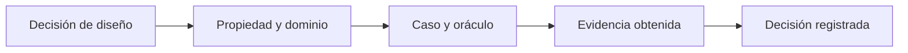

# Plano del banco de evidencia para algoritmos

**Estado** · Diseño v0.1.  
**Clase** · Método e instrumento de diseño experimental.  
**Usuario inicial** · Autor o revisor de un mecanismo nuevo que debe decidir entre dos diseños.  
**Pregunta de inversión** · ¿Una evidencia recuperada cambia o sustenta una decisión nueva con un esfuerzo de adaptación defendible?

## Propósito y primer alcance

Recuperar obligaciones, oráculos y contraejemplos **antes de completar una implementación**. La primera aplicación es una decisión de un candidato nuevo con estado y abstención. El banco empieza como fichas versionadas con soportes reproducibles. Una suite común merece un contraste propio cuando se acumulan casos con la misma interfaz y semántica.

La primera ficha puede escribirse antes de elegir motor o lenguaje. Conservará la referencia y una alternativa sencilla, incluso si el candidato favorecido cambia.

## Contrato de una ficha

| Bloque | Contenido necesario |
| --- | --- |
| Identidad y procedencia | Objeto, revisión, pregunta, autor o responsable, fuente del antecedente y condiciones en que se obtuvo. |
| Propiedad | Dominio, unidades, información permitida, supuestos, criterio exacto o tolerancia y relación con la decisión. |
| Evidencia prevista | Caso válido, contraejemplo o defecto inyectado, oráculo, comparador y condición de cierre. Fijarlos antes de ver resultados. |
| Ejecución | Comando o demostración, versiones, entradas, salida, primera divergencia y controles de sensibilidad. |
| Decisión y transferencia | Alternativas originales, decisión, límite, qué se reutilizó, cambios y esfuerzo de adaptación. Registrar una réplica dependiente como tal. |

La especificación matemática del candidato define estados, transformaciones e invariantes, además de la semántica del objetivo si se evalúa utilidad. La especificación computacional define representación, exactitud, traza y repetibilidad. El banco registra la relación entre ambas. Un oráculo manual puede decidir un caso finito. Un comparador externo debe acreditar independencia para la propiedad que se le atribuye. Una variante perturbada calibra la sensibilidad del instrumento.

## Boceto con tres fichas de partida

| Ficha | Propiedad | Caso discriminativo | Qué se puede trasladar |
| --- | --- | --- | --- |
| Unidades y corte temporal | Una predicción usa solo insumos elegibles y sus magnitudes admiten la transformación declarada. | Perturbar un sufijo y repetir con un caso cuyo término sensible sea distinto de cero. La sonda inicial de TN mostraba por qué ese segundo requisito importa. | La intervención y la obligación de declarar unidades. La relación de escala debe definirse para cada fórmula. |
| Partición y descenso | Cada llamada válida conserva la descomposición del dominio y reduce una medida de progreso. | Dos elementos desordenados y casos de mitad vacía o desigual. Comprobar terminación sin excepción y obligaciones del subrango. | La prueba previa sobre fronteras. Los rangos y la medida de descenso son propios del algoritmo. |
| Memoria y abstención | Una repetición inadmisible deja intactos el estado y la siguiente decisión. | Comparar una ejecución limpia, una con duplicado y una variante deliberada que actualiza memoria al recibir. | El control de identidad e información disponible. El significado de la abstención y el valor de la memoria los fija el candidato. |

### Caso trabajado · Memoria con abstención

La decisión de diseño es cuándo actualizar memoria, al recibir o después de admitir. Para que el caso discrimine, usar un modelo de juguete con contador inicial cero. Una confirmación admisible suma uno. La política emite acción cuando el contador llega a dos. La identidad es del evento subyacente.

| Secuencia de entrada | Oráculo de memoria | Oráculo de decisión |
| --- | ---: | --- |
| Confirmación A | 1 | Abstenerse |
| A seguida de retransmisión idéntica de A | 1 | Abstenerse |
| A seguida de confirmación válida B | 2 | Actuar |

El control adverso que cuenta entregas en vez de eventos emite una acción prematura en la segunda fila. Este es un ensayo propuesto sobre una política de juguete. Su resultado esperado se deriva del contrato escrito. Un candidato nuevo puede usar un estado diferente y debe ofrecer su propio caso discriminativo. La ventaja de incluir memoria exige otra comparación con una política fija y abstención, bajo un objetivo y condiciones reservadas. Un resultado correcto en este invariante no evalúa utilidad de mercado.

## Criterio de aceptación del banco

1. El revisor recupera una ficha para una **decisión prospectiva** y registra qué habría hecho antes de verla.
2. Fija dominio, oráculo y defecto conocido antes de ejecutar. Comprueba que el caso válido se acepta y que el defecto se detecta.
3. Registra qué opción cambió o qué evidencia justificó mantenerla. Mide esfuerzo de adaptación y calidad de la decisión frente al procedimiento habitual.
4. En otro diseño, mide qué parte pudo recuperarse sin rehacer el trabajo. Si la repetición solo alcanza a la formulación y al control, conserva el método. Si la interfaz y el oráculo se reutilizan, prueba un ejecutor compartido con un segundo candidato.

## Revisión multidisciplinaria y puente a especificación

| Afirmación y supuesto | Evidencia | Objeción y decisión |
| --- | --- | --- |
| Un caso pequeño puede descartar una arquitectura. | KS-004 registró un cambio prospectivo al perturbar un futuro que no debía estar disponible. | El alcance depende del caso. El primer ensayo del banco deberá declarar qué opciones compara y cuál preserva el invariante. |
| Un caso aprobado acredita sensibilidad. | KS-003 produjo una sonda favorable que casi anulaba el término sospechoso. | Verificación exige control positivo y control de defecto. Si ambos pasan, se mejora el instrumento antes de interpretar el resultado. |
| La misma prueba vale en varios dominios. | Los expedientes permiten recuperar patrones. | La semántica cambia con el objeto. Separar reutilización de la ficha de reutilización del ejecutable y medir ambas. |

**Paquete para especificar.** Formato versionado de ficha, flujo de autoría y revisión, entradas y salidas del ejecutor solo donde se demuestre su necesidad, y criterios para versionar el oráculo y el candidato por separado. El aporte organizacional es recuperar razonamiento y evidencia que puedan modificar un diseño. La mejora de productividad y una ventaja predictiva quedan como afirmaciones separadas.

**Fuentes** · [Catálogo de casos](../../KS-002_CATALOGO_CONOCIMIENTO.md) · [Sensibilidad de las sondas](../../KS-003_PLAN_INFRAESTRUCTURA.md) · [Decisión prospectiva en TN](../../KS-004_CONSTRUCCION_TECNOLOGICA.md) · [Caso de memoria y abstención](../../KS-008_SIGUIENTE_GENERACION_Y_TRANSFERENCIA.md) · [Mapa común](README.md)
