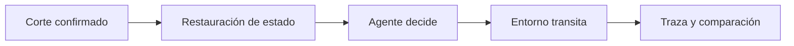

# Plano del laboratorio componible

**Estado** · Diseño v0.1.  
**Clase** · Arquitectura experimental para preguntas de trayectoria.  
**Usuario inicial** · Investigador que necesita comparar ejecución continua y reanudada de un agente con estado.  
**Pregunta de inversión** · ¿La combinación de sonda, entorno y registro permite verificar continuidad de comportamiento con un alcance que justifique su coste?

## Propósito y frontera inicial

Estudiar una política que, después de un corte, debe **generar acciones nuevas a partir de su estado y del entorno restaurado**. El núcleo histórico de WORLD-LAB es una referencia de comportamiento y replay. Una interfaz pública de reanudación sería parte de un candidato nuevo. Una sonda de un paso se mantiene como alternativa inicial si alcanza para responder la pregunta.

| Operación | Insumo distintivo | Afirmación que permite evaluar |
| --- | --- | --- |
| Replay del mundo | Acciones ya guardadas y origen identificado. | El mundo reproduce las transiciones para esa secuencia en el alcance probado. |
| Restauración de estado | Una representación del mundo y de la memoria o un método para reconstruirlos. | El estado restaurado coincide según la relación declarada. |
| Continuación autónoma | Estado restaurado, contexto pendiente y regla de decisión identificada. | El agente elige acciones nuevas y podemos comprobar si preserva el comportamiento de la corrida continua. |

Las operaciones de sonda y comparación pueden existir como herramientas externas. El registro temporal de KS-009 podría indexar el experimento y su evidencia. La semántica de restaurar el mundo, agente y recorder pertenece al laboratorio.

## Contrato candidato del punto de corte

El corte ocurre **después de confirmar y registrar una transición**, antes de entregar el siguiente feedback al agente. El contrato debe indicar si el resultado de una acción ya fue consumido. En el caso de FrontierMemory, mundo en tick 8 significa que el agente había procesado hasta la observación 7. El siguiente resultado de acción todavía formaba parte del contexto pendiente.

| Componente | Información mínima que se debe resolver en la especificación |
| --- | --- |
| Mundo | Configuración, mapa, recursos, entidad, tiempo, estado de ciclo y RNG, con representación identificada. |
| Agente | Identidad y revisión, estado privado necesario y RNG propio si aplica. Seleccionar exportación e importación o reconstrucción desde historial con supuestos explícitos. |
| Frontera de feedback | Último resultado de acción pendiente, referencia al siguiente origen y evidencia de lo ya consumido. |
| Registro | Identidad de ejecución, prefijo o referencia capaz de recuperarlo, orden y siguiente secuencia. Los tokens opacos del recorder actual están ligados a una instancia. |
| Compatibilidad | Versiones del motor, agente, formato, entorno de ejecución y política ante incompatibilidad o corte terminal. |

La especificación formal debe definir un estado conjunto y el orden **observar → decidir → transitar → confirmar**. Si el estado restaurado es equivalente en todos los componentes que influyen en la próxima transición y las operaciones son deterministas bajo los mismos insumos, puede formularse una prueba por inducción para el resto del episodio. Queda por definir qué significa equivalencia para cada componente y qué determinismo se exige. Si el candidato admite fuentes externas o aleatoriedad no restaurable, necesita otro contrato.

La especificación técnica decidirá representación portable, verificación de identidad, límites y errores. Debe rechazar checkpoints incompatibles o insuficientes antes de iniciar la continuación. La recuperación frente a una escritura interrumpida exige una frontera de durabilidad y un protocolo de fallos propios.

## Caso de referencia ya informado

El ensayo de Codex aportado por el propietario se realizó sobre `yellow@5d40f08fbb36c5bbe075628a5b9a9078ce9c017c`. Usó FrontierMemory, un mundo 6×6, horizonte 24 y corte posterior al registro del tick 8. Instantánea y reconstrucción mediante los ocho feedback previos produjeron 16 decisiones nuevas y el mismo resultado completo que la corrida continua. Con memoria vacía apareció una diferencia en la acción del tick 9 aunque RNG y terminación coincidieron. El replay de las acciones guardadas generó cero decisiones del agente.

Es evidencia informada para un caso y runtime identificados. El paquete original del arnés no está incorporado a este plano. El código de referencia sí permite comprobar la frontera de la API. `run_experiment` inicializa el mundo y reinicia el agente. La interfaz pública de agente documenta `reset/step`. El replay consume acciones. El plano no presupone un método público de restauración en el motor histórico. [Ejecución](https://github.com/ksgfin8-cyber/yellow/blob/5d40f08/js/experiment/experiment.js) · [Agente](https://github.com/ksgfin8-cyber/yellow/blob/5d40f08/js/agents/agent.js) · [Recorder](https://github.com/ksgfin8-cyber/yellow/blob/5d40f08/js/experiment/recorder.js#L175) · [Verificador de replay](https://github.com/ksgfin8-cyber/yellow/blob/5d40f08/tools/p01/archive.cjs#L99)

## Protocolo propuesto y decisión

| Contraste | Qué se mantiene y qué se cambia | Criterio |
| --- | --- | --- |
| Sonda de siguiente paso | Mismo mundo observable y feedback. Comparar memoria válida con memoria vacía o incompleta. | Detectar un caso donde el estado privado cambia la decisión. Si la sonda resuelve la pregunta, mantener el instrumento más simple. |
| Continuidad de trayectoria | Corrida continua frente a reanudación por instantánea y por reconstrucción. Regenerar el sufijo con el agente. | Igualdad acordada en acciones y estados, RNG, secuencias y terminación. Para afirmar continuidad completa, cotejar también feedback, eventos y registros. Si diverge, identificar el primer paso y campo. |
| Sensibilidad del contraste | Restaurar el mundo y omitir una parte de memoria o contexto. Reproducir acciones guardadas como control separado. | La prueba detecta una divergencia inducida en la acción cuando el caso exige memoria. Reportar por separado lo que acredita el replay del mundo. |
| Transferencia y coste | Otro corte, o un agente distinto si se pretende una interfaz común. | Conservar la propiedad y registrar cambios del adaptador, bytes preservados, pasos recalculados y tiempo de restauración. |

Probar otro corte evalúa sensibilidad a la ubicación del corte. Probar otro agente evalúa transferencia entre mecanismos. Elegir cuál ejecutar depende de la afirmación de avance. La ampliación a una interfaz de plataforma se justifica por una nueva capacidad observable o por menor coste de una comprobación equivalente.

## Revisión multidisciplinaria y puente a especificación

| Afirmación y supuesto | Evidencia | Objeción y decisión |
| --- | --- | --- |
| Restaurar el mundo basta para continuar. | El control con memoria vacía diverge en el primer paso nuevo. | Sistemas de transición exige modelar también el estado del agente y el feedback pendiente. |
| Exportar una instantánea es la mejor opción. | El informe obtuvo igualdad con instantánea y reconstrucción. | Operaciones compara almacenamiento, tiempo de reconstrucción y compatibilidad. Mantener ambas técnicas como alternativas de diseño hasta medir. |
| La combinación aporta valor. | KS-006 aporta recuperación local y KS-008 discrimina un efecto de la memoria en una trayectoria. | La integración debe conservar ambos contratos y resolver algo que la sonda deje abierto. Definir la pregunta antes de componer. |

**Paquete para especificar.** Modelo de transición y equivalencia, contrato de corte, identidad de ejecución, representación del checkpoint, API de continuación, errores y protocolo experimental. Aporta capacidad para distinguir integridad del replay y continuidad de una política. La durabilidad, varios escritores y la migración entre versiones requieren evidencia aparte.

**Fuentes** · [Perfil operativo WORLD-LAB](https://github.com/ksgfin8-cyber/yellow/blob/5d40f08/docs/audits/WORLD_LAB_OPERATIONAL_FREEZE.md) · [Recuperación de estado en KS-006](../../KS-006_DIMENSIONES_Y_RECUPERACION.md) · [Valor del replay en KS-007](../../KS-007_CADENA_TEMPORAL_Y_VALOR_DEL_LABORATORIO.md) · [Ablación de memoria en KS-008](../../KS-008_SIGUIENTE_GENERACION_Y_TRANSFERENCIA.md) · [Mapa común](README.md)
