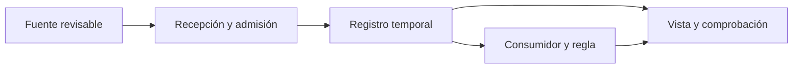

# Plano del observatorio de decisiones

**Estado** · Diseño v0.1.  
**Clase** · Aplicación interna apoyada en un registro temporal.  
**Usuario inicial** · Investigador u operador encargado de explicar una decisión sustentada en una fuente revisable.  
**Pregunta de inversión** · ¿Reconstruye el usuario una decisión con evidencia suficiente y menor trabajo que usando un archivo versionado y un script específico?

## Propósito y primer alcance

Permitir contestar **qué pudo conocer el consumidor, qué usó y qué cambió después**. El primer recorrido propuesto se limita a una fuente recurrente y un consumidor interno. El caso BEA de KS-008 y KS-009 sirve para diseñar el oráculo. El origen real, el dueño de la tarea y su frecuencia se fijarán antes de elegir un conector. Un umbral sirve para ejercitar el registro sin dar al ensayo una interpretación predictiva o de mercado.

El conector obtiene la publicación y deja constancia de la recepción. El adaptador decide qué entradas son admisibles. El registro preserva identidades, versiones y referencias. El consumidor aplica su regla y registra lo que efectivamente usó. La vista expone la evidencia. Un informe de consola o archivo es suficiente para la primera evaluación.

## Entidades y contrato inicial

| Entidad | Campos que deben llegar a la especificación | Responsabilidad |
| --- | --- | --- |
| Fuente y entrega | Identidad de fuente y entrega, contenido o referencia recuperable con huella, política de autenticidad, resultado de recepción. | Distinguir entrega repetida, fallo de consulta y ausencia de dato. |
| Observación versionada | Identidad de objeto, revisión, valor y unidad, procedencia, tiempo del hecho y de publicación si consta. | Preservar el original y la relación entre revisiones. |
| Admisión | Marca de recepción, marca de admisión, regla aplicada, disposición y causa. | Registrar desde cuándo es elegible para el consumidor. |
| Decisión | Identidad, consumidor, corte, frontera del registro, insumos, regla ejecutada y resultado. | Referenciar la implementación y configuración de la regla. Una etiqueta por sí sola permite rastreo, con capacidad limitada de recalcular. |
| Revisión de una decisión | Referencia histórica, dato corregido y recálculo opcional con identidad separada. | Distinguir las decisiones afectadas por una entrada de las decisiones cuyo resultado cambiaría al recalcular. |

La especificación matemática deberá definir elegibilidad y precedencia. Para la primera semántica, con corte `t` y frontera de versiones `k`, considerar únicamente versiones admitidas hasta `t` y ya confirmadas hasta `k`. Seleccionar la mayor revisión elegible según el orden definido por el adaptador. Una fecha anterior de un registro cargado después puede cambiar la vista retrospectiva, mientras `k` preserva la decisión histórica. Precisar qué sucede ante revisiones parciales, empates o reversiones antes de reclamar soporte a esos casos.

La especificación computacional deberá distinguir `observar`, `admitir`, `consultar al corte` y `registrar decisión`. Identidad de revisión e identidad de entrega son distintas. Un duplicado exacto conserva la admisión ya confirmada. Un conflicto de identidad se registra para resolución. La regla y sus insumos deben quedar enlazados de forma recuperable. La salida distingue tres niveles de evidencia. Una decisión puede ser **rastreable**, **recalculada con el mismo contrato** o **reanudable con estado**. El tercero pertenece a un consumidor con memoria y exige otra prueba.

## Boceto de un caso completo

En KS-009 el comunicado de mayo se publicó a las 12:30:00 UTC. El caso modeló recepción a las 12:30:01 y admisión a las 12:30:02. Antes de admitir, la decisión de umbral podía usar 1,6 %. Al admitir, podía usar 1,3 %. Son marcas simuladas para probar la semántica.

| Zona de consulta | Qué devolvería para el caso |
| --- | --- |
| Entrada | Revisión, referencia de origen, marcas conocidas y decisión de admisión. La vista etiqueta recepción y admisión como simuladas en este caso. |
| Decisión histórica | Corte, valor de 1,6 %, referencia de regla y resultado del umbral. Se puede consultar el dato preciso que usó. |
| Cambio posterior | La nueva versión vale 1,3 %. El impacto lista decisiones que usaron la revisión anterior. Un recálculo mostraría su propio resultado e identidad. |
| Incidencia | Una consulta fallida, una corrección incompatible y una observación todavía pendiente tienen disposiciones distinguibles. |

## Protocolo previo y decisión de inversión

| Prueba propuesta | Oráculo o comparador | Criterio para avanzar |
| --- | --- | --- |
| Corte, revisión y carga tardía | Tabla manual de valores y un archivo versionado con script. Un control carga solo el último valor. | Cada corte usa la revisión esperada. La retrospectiva cambia cuando corresponde y la decisión guardada conserva sus insumos. El control negativo diverge. |
| Recepción observada y reintento | Fuente pública identificada o productor interno autorizable, registro de entrega y corrida limpia. | Se puede rastrear la recepción observada y reconstruir tras un reintento sin duplicar la versión efectiva en el perfil probado. |
| Encadenamiento de la regla | Recálculo controlado con implementación y configuración identificadas. | El cálculo concuerda con el resultado almacenado con la precisión pactada. Una revisión de regla produce una decisión identificada por separado. |
| Valor para el usuario | Mismo caso con el script de referencia y el informe de consulta. | Al menos una comprobación relevante antes inaccesible, o una reducción acordada de trabajo, con la misma calidad de evidencia. |

**Criterio de alcance.** El primer candidato queda local y para un consumidor. La interfaz visual se considera si se observa una tarea recurrente cuya consulta sería más fácil de verificar o ejecutar. La segunda fuente sirve para probar transferencia, con adaptación medida. La especialización económica conserva unidades, calendario y reglas temporales propias. En otros dominios se reutiliza el registro de procedencia, corte e identidad, sujeto a los contratos de cada conector.

## Evidencia, objeciones y siguiente especificación

| Afirmación y supuesto | Evidencia disponible | Objeción y decisión |
| --- | --- | --- |
| El registro puede preservar entradas históricas bajo su frontera. | KS-009 lo ejercitó en dos usos locales. | La prueba no cubre un flujo recibido en operación ni persistencia concurrente. Construir primero el conector y la prueba de reconstrucción. |
| Rastrear por etiqueta de regla permite explicar una decisión registrada. | KS-009 conserva regla, entradas y resultado. | Para recalcular hace falta identidad ejecutable. Definir el enlace entre versión, código y configuración antes de prometer recálculo. |
| Un observatorio reduce trabajo repetitivo. | Hay una tarea candidata y un registro reutilizable. | El script puede ser más barato. Medir consultas, excepciones y esfuerzo de operación antes de ampliar. |

**Paquete para especificar.** El siguiente documento deberá resolver el modelo temporal, esquema e identidades, API de admisión y consulta, forma de conservar bruto y reglas, errores, idempotencia y procedimiento de operación. El plano aporta una base para auditoría interna. La observabilidad sostenida, la interfaz útil en campo y la economía compartida esperan prueba propia.

**Fuentes** · [KS-007](../../KS-007_CADENA_TEMPORAL_Y_VALOR_DEL_LABORATORIO.md) · [KS-008](../../KS-008_SIGUIENTE_GENERACION_Y_TRANSFERENCIA.md) · [KS-009](../../KS-009_REGISTRO_TEMPORAL_Y_EVIDENCIA_DE_DISENO.md) · [Caso histórico de admisión en LAB2](https://github.com/ksgfin8-cyber/LAB2/blob/0c21d18/docs/research/LAB2_RDL_PB_001_EVALUATION.md) · [Mapa común](README.md)
