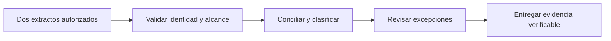

# Plano del piloto externo de reconciliación

**Estado** · Diseño v0.1 condicionado a un receptor.  
**Clase** · Validación operativa de un servicio acotado.  
**Usuario inicial** · Responsable de un proceso que compara dos extractos y resuelve discrepancias.  
**Pregunta de inversión** · ¿Puede el receptor verificar y usar la conciliación con un coste de adaptación y soporte que justifique repetirla?

## Propósito y límites de la oferta

Entregar **pares conciliados, excepciones explicadas y evidencia suficiente para comprobar el resultado**. La primera especialización candidata es logística, con despachos y recepciones de un mismo periodo y reglas de cantidad o identidad acordadas. El alcance preferido es una entrega por lote, con una modificación de regla y una corrección autorizada. La continuidad automatizada se evalúa cuando el receptor tenga una necesidad recurrente.

Antes del piloto debe existir un responsable autorizado, dos extractos representativos que pueda compartir, un periodo delimitado, el procedimiento de referencia y un criterio de aceptación. Hay que confirmar qué constituye una recepción en el proceso real. Cuando esos insumos falten, la fixture local permite revisar el diseño y el oráculo.

## Contrato preliminar

| Objeto | Qué se fija antes de ejecutar |
| --- | --- |
| Extracto | Identidad, periodo, origen, permisos de uso, formato, unidades y tratamiento de versiones o cortes distintos. |
| Emparejamiento | Clave y cardinalidad, normalización aceptada, precedencia de correcciones y manejo de empates. Una clave ambigua queda pendiente de resolución. |
| Clasificación | Coincidencia, diferencia, falta de despacho, recepción pendiente o conflicto. Una tolerancia opera solo sobre cantidades comparables. |
| Corrección | Quién autoriza, referencia del soporte y versión. La revisión deja consultable el resultado anterior. |
| Entrega | Resultado, versión de las reglas, referencias de entrada, lista de excepciones y procedimiento de verificación acordado con el receptor. |

La futura especificación matemática puede describir una relación parcial de emparejamiento y predicados de clasificación. Su primera obligación es que cada registro dentro del alcance tenga una disposición y que el total pueda reconciliarse con la entrada, incluidos duplicados y excepciones. La especificación técnica fijará el formato de entrada y salida, los controles de integridad, la forma de repetir el cálculo y la evidencia de cambios. La parte operativa fijará aceptación, resolución de excepciones, responsable y alcance de soporte.

## Boceto de entrega · Caso de diseño sintético

| Identidad | Despacho | Recepción | Regla | Resultado que el receptor podría verificar |
| --- | ---: | ---: | --- | --- |
| G1 | 2 | 2 | Tolerancia 0 | Coincide, con referencia a los dos registros. |
| G2 | 4 | 5 | Tolerancia 0 | Diferencia de una unidad y los dos valores de origen. |
| G3 | 1 | Sin comprobante | Confirmación por receptor | Recepción pendiente. El despacho conserva su referencia. |
| G4 | Sin registro | 5 | Emparejar dentro del periodo | Falta despacho en el alcance pactado. |

Si se acuerda tolerancia 1, cambia G2 y se conserva la condición de G3. Si llega una recepción corregida a 4, se registra qué autorización y qué versión produjeron el nuevo resultado. Estos resultados esperados corresponden a una fixture. Una guía real podría tener múltiples recepciones parciales, unidades diferentes o una clave compuesta. Su contrato se acuerda con el receptor antes de clasificarla.

El primer flujo puede implementarse con un script y archivos versionados. El registro compartido aporta valor si el usuario necesita resolver revisiones o explicar un resultado anterior. Esa elección se compara en el mismo caso. Las herramientas propietarias y el corpus general de pruebas pueden mantenerse internos. La entrega debe incluir las reglas que afectan al receptor y evidencia suficiente para que verifique su resultado. La custodia y el acceso se definen para el caso autorizado.

## Protocolo de campo y criterio de inversión

1. **Fijar tarea y referencia.** Tomar el mismo periodo y los mismos extractos para el procedimiento actual y el candidato. Acordar qué discrepancias requieren acción, cómo se cuentan y qué salida verifica el receptor. Fijar antes del contraste el tiempo o esfuerzo que justificaría un cambio.
2. **Calificar el instrumento.** Ejercer coincidencia, faltante, discrepancia de cantidad y conflicto de identidad. Introducir un duplicado y un despacho sin comprobante como controles negativos. Comparar con el oráculo manual.
3. **Ejecutar un lote con revisión del receptor.** Conservar entradas, reglas, resultados, intervención manual y excepciones. El receptor comprueba el lote acordado y confirma qué diferencias puede usar para actuar.
4. **Cambiar una regla o incorporar una corrección.** Medir preparación, resolución de excepciones y soporte en ambos procedimientos. Verificar que la revisión explica qué cambió y que se puede recuperar el resultado anterior.
5. **Decidir.** Mantener el piloto si el receptor acepta y verifica la entrega, se conservan los mínimos de integridad acordados y se obtiene la diferencia de esfuerzo o de capacidad acordada. Si la referencia satisface la tarea a menor coste y con evidencia equivalente, conservar el aprendizaje y ajustar la oferta.

El piloto puede acreditar utilidad para **un receptor y un proceso**. La transferencia comercial requiere otro receptor o una repetición representativa con cambios medidos. Resultados en esta fixture no establecen demanda, márgenes ni escala.

## Revisión multidisciplinaria y puente a especificación

| Afirmación y supuesto | Evidencia | Objeción y decisión |
| --- | --- | --- |
| Las discrepancias pueden reproducirse con otra implementación. | KS-008 verificó la equivalencia de Python y SQL para tolerancias cero y uno. KS-009 usó el mismo núcleo que el caso económico. | Un cliente puede tener recepciones parciales o claves ambiguas. Definir la cardinalidad antes de reutilizar una regla. |
| El despacho acredita recepción. | El caso de Almuerzos muestra que una acción local puede quedar registrada sin confirmación externa. | Ingeniería de operaciones exige evidencia del receptor. Mantener estado pendiente en ausencia de comprobante. |
| El candidato ahorra tiempo de trabajo. | Hay una fixture y una salida reproducible. | Medición exige contar atención, excepciones y modificaciones, además de tiempo de cómputo. Un lote emparejado decide si vale la pena operar. |

**Paquete para especificar.** Contrato de datos, reglas de emparejamiento y clasificación, esquema de entrega, protocolo de aceptación, medición frente a referencia y procedimiento de corrección. Aporta una ruta controlada para convertir capacidad interna en trabajo verificable para terceros. La decisión comercial depende de evidencia de uso y coste.

**Fuentes** · [Reconciliación sintética en KS-008](../../KS-008_SIGUIENTE_GENERACION_Y_TRANSFERENCIA.md) · [Transferencia local en KS-009](../../KS-009_REGISTRO_TEMPORAL_Y_EVIDENCIA_DE_DISENO.md) · [Frontera de entrega de Almuerzos Ecuador](https://github.com/ksgfin8-cyber/almuerzos-ecuador/blob/af7cf32/docs/research/almuerzos-ecuador-rdl-pb-001.md) · [Mapa común](README.md)
