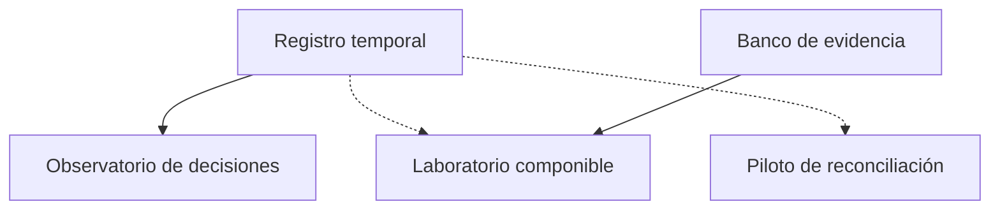

# Planos de diseño para la siguiente generación tecnológica

**Estado** · Planos v0.1 para revisión.  
**Corte documental** · 25 de noviembre de 2026, Ecuador.  
**Base de evidencia** · `engineering-knowledge@772cb1fbcf77365d0aa48ebb7d3d4d5dbfb3f0a6`, Especificación Estratégica, RDL-PB-001 y el informe de viabilidad de reanudación aportado por el propietario.

## Propósito

Preparar cuatro decisiones de construcción. Cada plano define un usuario o investigador, un recorrido de extremo a extremo, la propiedad que tendría que preservar una implementación y un contraste capaz de cambiar la decisión de avanzar. Los ejemplos de aceptación son especificaciones propuestas. Los resultados observados quedan atribuidos a sus expedientes.

| Plano | Qué construiría | Qué debe quedar resuelto antes de implementar |
| --- | --- | --- |
| [Observatorio de decisiones](OBSERVATORIO_DE_DECISIONES.md) | Un recorrido interno que reconstruye qué sabía un consumidor cuando decidió. | Fuente recurrente, prueba de recepción, orden de admisión y modo de identificar la regla ejecutada. |
| [Banco de evidencia para algoritmos](BANCO_DE_EVIDENCIA.md) | Un conjunto pequeño de fichas y casos que se usan para decidir un diseño nuevo. | Primera decisión real, alcance del invariante, oráculo y caso que expone el defecto. |
| [Laboratorio componible](LABORATORIO_COMPONIBLE.md) | Una composición acotada de entorno, agente, registro y comparación para estudiar continuidad. | Interfaz del corte, estado necesario y alcance de equivalencia con una corrida continua. |
| [Piloto externo de reconciliación](PILOTO_DE_RECONCILIACION.md) | Un servicio experimental de conciliación verificable para un receptor. | Proceso existente, datos autorizados, evidencia de recepción, criterios de aceptación y límite de soporte. |

## Relaciones y alcance

La línea continua del registro al observatorio indica reutilización propuesta del núcleo de KS-009. La línea del banco al laboratorio indica que los casos mínimos pueden fijar un contraste, con independencia del soporte donde se documenten. Las líneas discontinuas indican integraciones opcionales. Para el laboratorio, el registro puede indexar checkpoints, entradas y resultados. La recuperación exige sus propios contratos de estado y ejecución. Para el piloto, el registro solo entra si conservar versiones o reconstruir decisiones aporta valor a la tarea del receptor.

Los repositorios históricos siguen como fuentes de referencia. `engineering-knowledge` aloja planos y evidencia. Sus documentos no cuentan como objetos tecnológicos adicionales en la cartera. Un candidato construido a partir de estos planos tendrá identidad propia.

## Generalización y especialización

| Tipo de afirmación | Qué exige |
| --- | --- |
| Reproducibilidad | Repetir el resultado bajo condiciones equivalentes y preservar versión, configuración y evidencia. |
| Robustez | Perturbar una condición relevante y comprobar qué propiedad se conserva y cuál cambia. |
| Generalización por contrato | Declarar el dominio, los supuestos y la propiedad. Probarla formalmente o verificar exhaustivamente un dominio finito identificado. Una implementación requiere verificar su conformidad con el contrato. |
| Generalización empírica | Predefinir la familia de condiciones, las dimensiones que varían y el criterio. Usar casos nuevos que puedan refutar la propiedad. Onboarding, carga y concurrencia requieren pruebas distintas. |
| Transferencia | Ejercer la propiedad en un receptor diferente, medir la adaptación y conservar las condiciones de validez de origen y destino. |

El estado actual permite afirmar transferencia del registro de KS-009 **entre dos usos locales**. Permite afirmar viabilidad de reanudación **para una configuración concreta de FrontierMemory**, según el informe aportado. La semántica temporal puede aspirar a una afirmación formal bajo supuestos de preservación. La utilidad de producto, el coste recurrente y la generalización a nuevos agentes o sectores se evalúan en sus contextos. La especialización se juzga por su desempeño en una tarea definida dentro de un dominio.

## Revisión multidisciplinaria y decisiones de inversión

| Decisión | Disciplina que aporta un criterio | Objeción que debe poder cambiar el resultado | Evidencia que decide |
| --- | --- | --- | --- |
| Adoptar un registro en vez de un archivo versionado | Semántica temporal y arquitectura de datos | El archivo puede responder la pregunta con el mismo rigor y menor operación. | Reconstruir la misma decisión ante una corrección, con coste comparable y una autoridad verificable. |
| Pasar del catálogo a un banco ejercido | Lógica, verificación y diseño experimental | El caso puede aprobar una implementación defectuosa o servir solo al candidato histórico. | Oráculo, defecto conocido y decisión prospectiva, con adaptación observada. |
| Usar instantánea o reconstrucción histórica | Sistemas de transición e ingeniería de operaciones | La instantánea puede exigir compatibilidad y mantenimiento que la reconstrucción evita. | Equivalencia desde un mismo corte, volumen preservado y coste de recuperación para el uso previsto. |
| Proponer reconciliación como servicio | Ingeniería de operaciones y medición | La automatización puede mover trabajo al receptor o al soporte. | Tarea emparejada, excepciones resueltas, evidencia que el receptor pueda comprobar y coste total observado. |

Cada revisión identifica **afirmación, supuesto, evidencia, objeción y decisión afectada**. El desacuerdo se conserva hasta contar con evidencia discriminativa. Las primeras pruebas no justifican por sí mismas una plataforma común. La inversión más reversible empieza con una decisión interna observada y una ficha usada en un diseño. El laboratorio se compone para una pregunta que exige trayectoria. El piloto queda listo para el momento en que exista un receptor que pueda comparar su procedimiento actual.

## Fuentes y límites de esta edición

- [KS-001 a KS-009](../../) contienen la cartera, el catálogo, las comparaciones y los instrumentos que se referencian en cada plano.
- [RDL-PB-001 v0.1, §§6–9, 11–14, 17, 19–20 y 23](https://github.com/ksgfin8-cyber/yellow/blob/5d40f08/docs/program/RDL-PB-001_v0.1_original_propuesta.md) rige la formulación, evidencia, economía y cierre.
- [Especificación Estratégica, §§7, 11–17, 25, 29, 44–48, 52, 54 y 62](https://chatgpt.com/library?file_id=libfile_e0932365a6ac8191a15982b0355879e0&account_id=personal) fundamenta especialización, proporcionalidad, acumulación y transferencia.
- El informe de reanudación de Codex aportado por el propietario se refiere a `yellow@5d40f08fbb36c5bbe075628a5b9a9078ce9c017c`. El [plano del laboratorio](LABORATORIO_COMPONIBLE.md) conserva su alcance y las interfaces contrastables. La evidencia ejecutable del arnés no está incorporada a esta edición.
